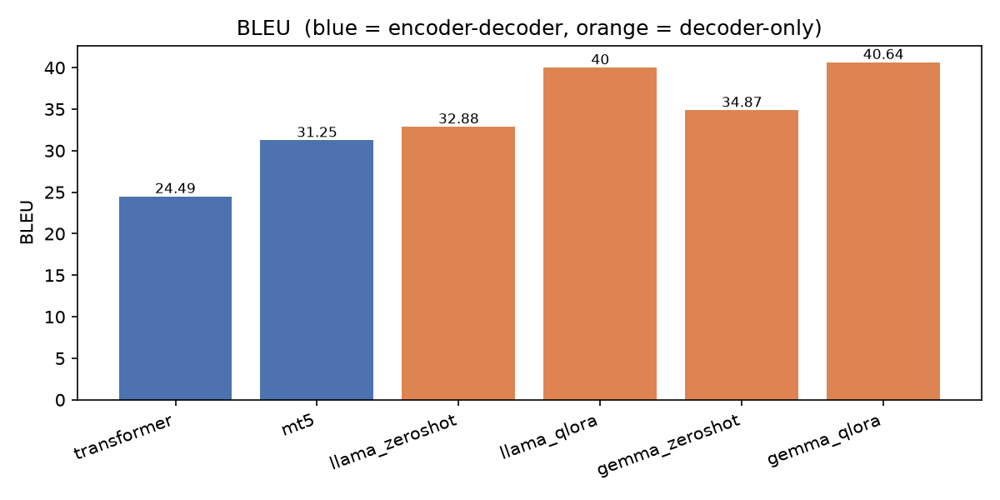
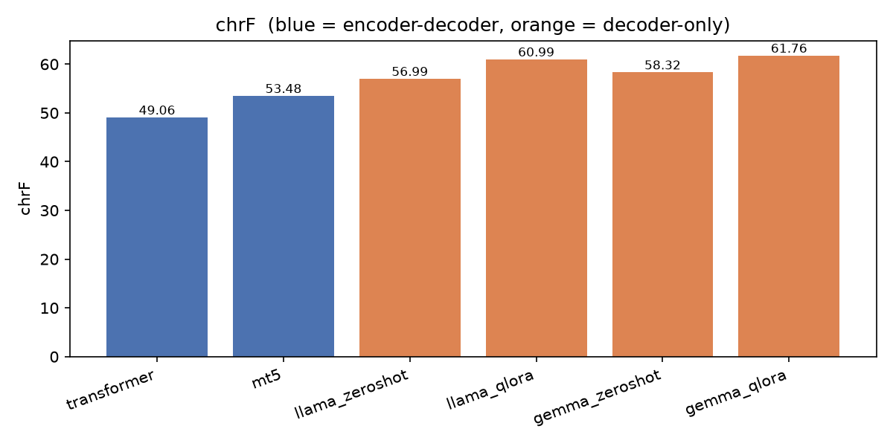
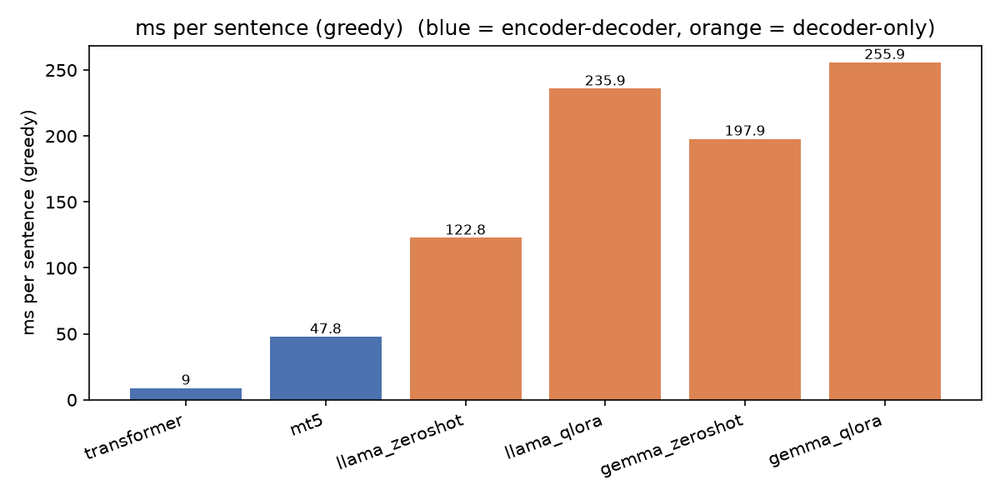
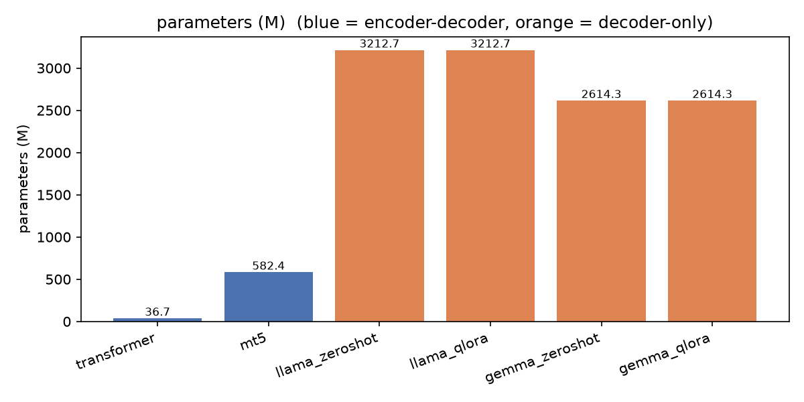
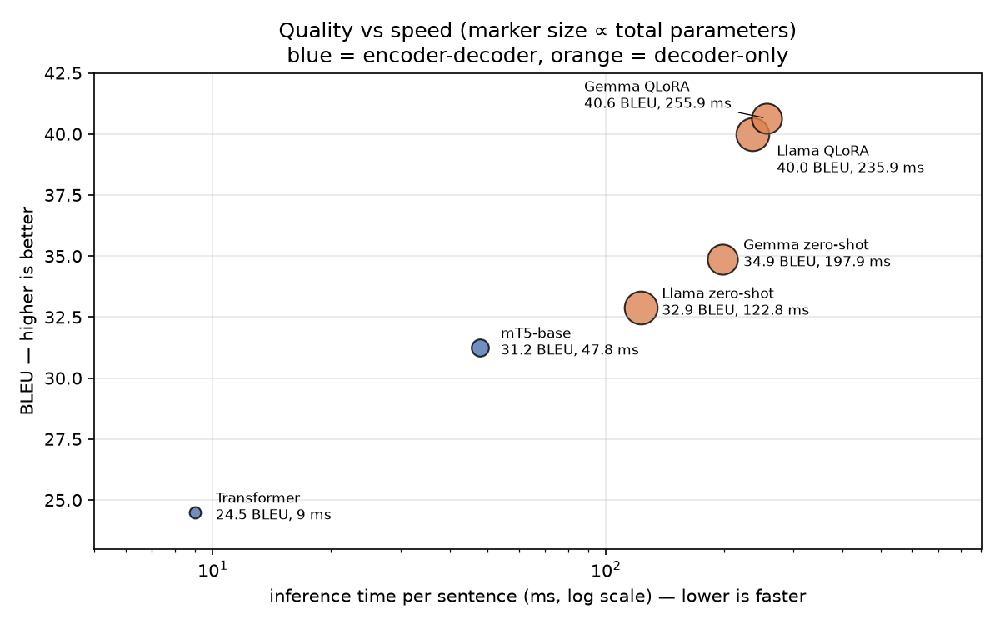
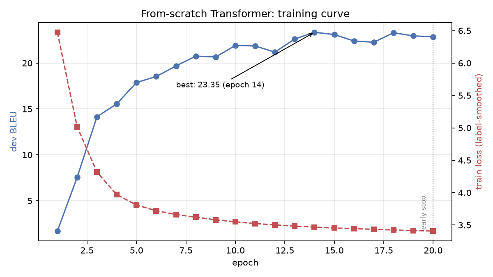
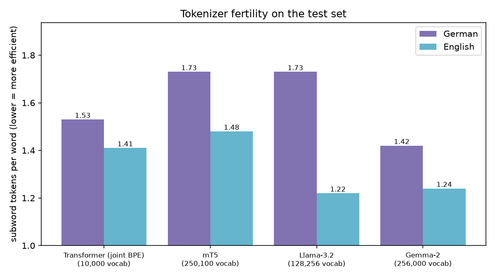
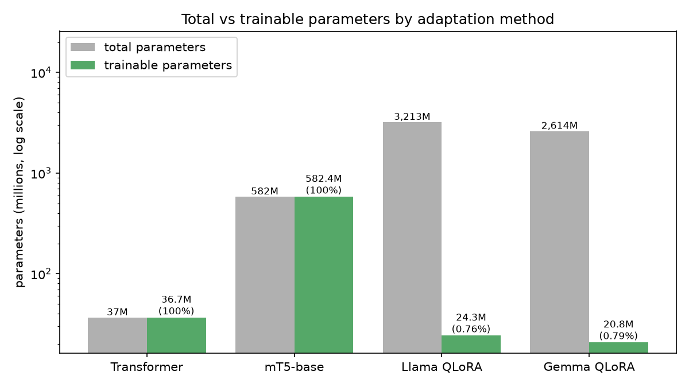
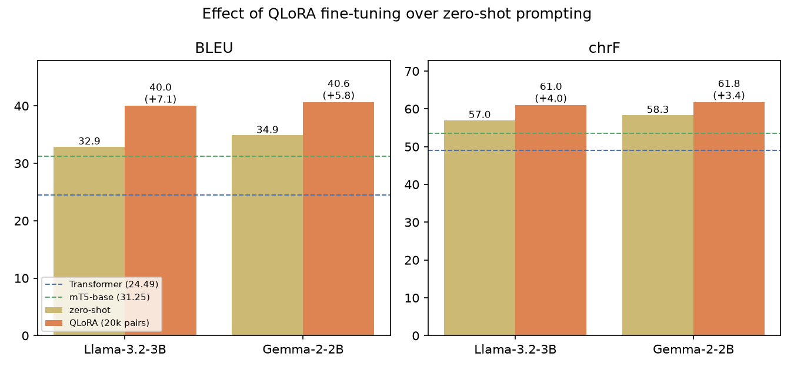

# German → English Machine Translation: Transformer vs mT5 vs Llama vs Gemma

This project builds four machine-translation systems for **German → English** and compares them on the same test set, using the same decoding settings and the same GPU:

| # | Model | Architecture | How it was adapted |
|---|---|---|---|
| 1 | **Transformer** (built from scratch) | encoder–decoder | trained from random initialisation |
| 2 | **mT5-base** | encoder–decoder, pretrained | full fine-tuning |
| 3 | **Llama-3.2-3B-Instruct** | decoder-only LLM | zero-shot prompting **and** QLoRA fine-tuning |
| 4 | **Gemma-2-2B-it** | decoder-only LLM | zero-shot prompting **and** QLoRA fine-tuning |

Each model is scored with **BLEU**, **chrF** (and chrF++), **training time**, **inference time**, **parameter count** and **peak GPU memory**. The comparison then looks at how model size, pretraining, tokenization and adaptation method explain the differences.

> **Headline result:** both fine-tuned LLMs reach about **40 BLEU / 61–62 chrF**. Gemma-2-2B scores 40.6 BLEU and Llama-3.2-3B 40.0, and their 95% confidence intervals overlap, so they are effectively tied. That is **+16 BLEU over the from-scratch Transformer** (24.5) and **+9 over fine-tuned mT5** (31.3). QLoRA trains less than 1% of each LLM's weights and uses under 4 GB of VRAM. The Transformer is still **about 28× faster** at inference.

---

## Contents

1. [Results at a glance](#1-results-at-a-glance)
2. [Dataset](#2-dataset)
3. [Preprocessing and splits](#3-preprocessing-and-splits)
4. [Models and training](#4-models-and-training)
5. [Inference setup](#5-inference-setup)
6. [Evaluation](#6-evaluation)
7. [Analysis and comparison](#7-analysis-and-comparison)
8. [Example translations](#8-example-translations)
9. [Limitations](#9-limitations)
10. [Reproducing the results](#10-reproducing-the-results)
11. [Repository layout and file descriptions](#11-repository-layout-and-file-descriptions)

---

## 1. Results at a glance

All numbers are on the same 1,000-sentence IWSLT 2017 test subset. Every model used greedy decoding on one **NVIDIA RTX 3080 Laptop GPU (8 GB)**.

| Model | BLEU ↑ | chrF ↑ | chrF++ ↑ | Total params | Trainable params | Training pairs | Training time | Inference (1,000 sentences) | ms / sentence | Peak memory, train / inference |
|---|---|---|---|---|---|---|---|---|---|---|
| Transformer (scratch) | 24.49 | 49.06 | 47.85 | 36.7 M | 36.7 M | 204,044 | 48 min | **9.0 s** | **9** | 2.1 / **0.4** GB |
| mT5-base (full FT) | 31.25 | 53.48 | 52.54 | 582 M | 582 M | 60,000 | 104 min* | 47.8 s | 48 | 5.1 / 1.6 GB |
| Llama-3.2-3B, zero-shot | 32.88 | 56.99 | 55.50 | 3,213 M | 0 | 0 | none | 122.8 s | 123 | – / 2.6 GB |
| Gemma-2-2B, zero-shot | 34.87 | 58.32 | 56.92 | 2,614 M | 0 | 0 | none | 197.9 s | 198 | – / 2.7 GB |
| Llama-3.2-3B, QLoRA | 40.00 | 60.99 | 60.01 | 3,213 M | 24.3 M (0.76%) | 20,000 | 68 min | 235.9 s | 236 | 4.0 / 2.9 GB |
| **Gemma-2-2B, QLoRA** | **40.64** | **61.76** | **60.79** | 2,614 M | 20.8 M (0.79%) | 20,000 | 159 min | 255.9 s | 256 | 4.0 / 2.7 GB |

\* mT5's first 1,000 of its 1,875 steps ran while GPU memory was overflowing into system RAM, which made them about 10× slower (see [§4.2](#42-mt5-base--full-fine-tuning)). Its training time is therefore extrapolated from the 875 steps that ran normally after the fix. The wall-clock time actually measured was 48.6 min of training after resuming plus the slow first part.

Sacrebleu signatures: BLEU `nrefs:1|case:mixed|eff:no|tok:13a|smooth:exp|version:2.6.0`, chrF `nrefs:1|case:mixed|eff:yes|nc:6|nw:0|space:no|version:2.6.0`.

| BLEU | chrF |
|---|---|
|  |  |

| Inference time | Parameters |
|---|---|
|  |  |

### Quality vs speed



Better translation quality costs inference speed: going from the 9 ms Transformer to the best LLM gains 16 BLEU but makes each sentence about 28× slower. mT5 sits in between. Fine-tuning with QLoRA moves each LLM up (better quality) and to the right (slower). The slowdown comes mainly from the LoRA adapter, which is kept separate from the 4-bit base weights and adds extra matrix multiplications in every layer. The fine-tuned models also write about 3% more words (more complete translations, closer to the reference length).

### Statistical significance

I ran a paired bootstrap resampling test (sacrebleu `--paired-bs`, 1,000 resamples) with the Transformer as the baseline. Results are in [`results/significance.txt`](results/significance.txt).

| System | BLEU (95% CI) | chrF (95% CI) | p vs Transformer |
|---|---|---|---|
| Transformer | 24.5 ± 1.1 | 49.1 ± 0.9 | – |
| mT5-base | 31.3 ± 1.3 | 53.5 ± 1.1 | 0.001 |
| Llama zero-shot | 32.9 ± 1.4 | 57.0 ± 1.0 | 0.001 |
| Gemma zero-shot | 34.9 ± 1.4 | 58.3 ± 1.1 | 0.001 |
| Llama QLoRA | 40.0 ± 1.4 | 61.0 ± 1.0 | 0.001 |
| Gemma QLoRA | 40.7 ± 1.4 | 61.8 ± 1.0 | 0.001 |

Every system differs significantly from the Transformer (p < 0.05). The confidence intervals of **Llama QLoRA and Gemma QLoRA overlap almost completely**, so the 0.6 BLEU gap between them should be read as a tie, not a win. The gap between each zero-shot LLM and its QLoRA version (+5.8 and +7.1 BLEU) is far larger than the confidence intervals.

---

## 2. Dataset

**IWSLT 2017 German–English** (`IWSLT/iwslt2017`, config `iwslt2017-de-en` on the Hugging Face Hub). It contains transcripts of **TED talks** with their human English translations, aligned sentence by sentence.

Why this dataset:
- **Public and standard.** IWSLT de-en is one of the most used MT benchmarks, so the numbers can be compared with published work.
- **The right size for an 8 GB GPU.** About 200k sentence pairs is enough to train a Transformer from scratch to a reasonable level, but small enough to do it in under an hour.
- **Spoken, conversational register.** TED talks contain informal speech, idioms and named entities. This makes the task harder than news text and shows clear differences between models.
- **A high-resource language pair.** All three pretrained models (mT5, Llama, Gemma) list German among their supported languages, so the comparison is fair.

| Split (raw) | Pairs |
|---|---|
| train | 206,112 |
| validation (dev2010) | 888 |
| test (tst2010–2015) | 8,079 |

Statistics after cleaning (from [`data/stats.json`](data/stats.json)):

| Split | Pairs | German words/sentence (mean / median) | English words/sentence (mean / median) | German vocabulary | English vocabulary |
|---|---|---|---|---|---|
| train | 204,044 | 16.2 / 13 | 17.4 / 14 | 215,049 | 127,351 |
| dev | 888 | 18.6 / 15 | 19.6 / 16 | 5,097 | 4,361 |
| test (subset) | 1,000 | 15.4 / 13 | 16.2 / 14 | 5,211 | 4,456 |

German has a much larger word vocabulary than English (215k vs 127k types). This comes from compounding (*Kinderlähmung*, *Roboterfahrzeugen*) and inflection. It is the main reason subword tokenization matters for this language pair (see [§7.3](#73-tokenization)).

---

## 3. Preprocessing and splits

Code: [`00_prepare_data.py`](00_prepare_data.py)

1. **Loading.** The dataset is read from the Hub's auto-converted Parquet files, so no dataset loading script is executed.
2. **Normalisation.** Unicode NFC normalisation (so `ü` is always one code point), then whitespace is collapsed and trimmed.
3. **Filtering** (training set only):

   | Rule | Pairs removed |
   |---|---|
   | Source sentence also appears in dev or test (data leakage) | 1,390 |
   | Exact duplicate pair | 484 |
   | Length ratio > 2.5 (when both sides have more than 3 words), a sign of misalignment | 143 |
   | Either side longer than 80 words | 51 |
   | Empty side | 0 |
   | **Total removed** | **2,068 (1.0%)** |

4. **Test set.** The official test set has 8,079 pairs. Decoding it with six systems, including 3B-parameter LLMs, on a laptop GPU would take hours, so a **fixed random subset of 1,000 pairs** (seed 42) is used. Every system translates exactly this subset. The ± 1.1–1.4 BLEU confidence intervals above show that 1,000 sentences is enough to separate the systems.
5. **Dev set.** The full 888-pair dev2010 set is used for early stopping and checkpoint selection. The LLMs use its first 300 pairs for dev loss, to save time.
6. **Training subsets.** The training set is shuffled once with seed 42. Each model trains on a **prefix** of that shuffled list, so the smaller subsets are contained in the larger ones:

   | Model | Training pairs | Reason |
   |---|---|---|
   | Transformer | 204,044 (all) | Trained from scratch, so it needs all the data it can get |
   | mT5-base | 60,000 | Pretrained, and full fine-tuning of 580M parameters is slow on 8 GB |
   | Llama / Gemma | 20,000 | Strong pretrained models; QLoRA adapts them with few examples |

   The different sizes are a deliberate design choice and part of the comparison: **how much parallel data each approach needs**. Training every model on 204k pairs would take more than 15 GPU-hours for the LLMs alone.

Model-specific preprocessing (tokenization, prompts) is described with each model below.

---

## 4. Models and training

Everything runs on one RTX 3080 Laptop GPU (8 GB VRAM) with 16 GB of system RAM, on Windows 11. All training uses **bf16 mixed precision** and seed 42.

### 4.1 Transformer (built from scratch)

Code: [`transformer_model.py`](transformer_model.py), [`01_train_transformer.py`](01_train_transformer.py)

This is a standard encoder–decoder Transformer (Vaswani et al., 2017) built on `torch.nn.Transformer`. It is sized for a dataset of this scale, along the lines of the well-known fairseq `transformer_iwslt_de_en` configuration.

| Setting | Value |
|---|---|
| Tokenizer | **Joint SentencePiece BPE with 10k vocabulary**, trained on the German and English training text together |
| Layers | 6 encoder + 6 decoder |
| d_model / FFN / heads | 512 / 1024 / 4 |
| Normalisation | Pre-LayerNorm (more stable than the original post-LN) |
| Embeddings | Shared source/target/output embedding (possible because the vocabulary is joint) and sinusoidal positions |
| Dropout | 0.3 |
| **Parameters** | **36.7 M** |
| Loss | Cross-entropy with label smoothing 0.1 |
| Optimiser | Adam (β = 0.9, 0.98), inverse-square-root learning-rate schedule, peak 5e-4, 4,000 warm-up steps |
| Batching | Token-based: about 4,096 tokens per batch, sentences grouped by length |
| Stopping | Early stopping on dev BLEU (patience 6 epochs), with caps of 40 epochs and 2.5 h |

Training stopped early after **20 epochs (28,380 steps, 48 min)**. The best dev BLEU was **23.35, at epoch 14**, and that checkpoint is the one used for testing.



Dev BLEU rises quickly for the first 8 epochs and then levels off around 22–23, while training loss keeps falling slowly. The model reached the limit of what 204k sentence pairs can teach it, so early stopping ended the run 6 epochs after the best score.

### 4.2 mT5-base — full fine-tuning

Code: [`02_finetune_mt5.py`](02_finetune_mt5.py)

[`google/mt5-base`](https://huggingface.co/google/mt5-base) is a multilingual T5 encoder–decoder pretrained on mC4, which covers 101 languages. Pretraining was span corruption only, with **no translation data**, so the model has to learn the task during fine-tuning.

| Setting | Value |
|---|---|
| Parameters | 582 M (all trained) |
| Tokenizer | mT5's SentencePiece unigram model, 250k vocabulary |
| Input format | `translate German to English: <German sentence>`, at most 128 tokens |
| Optimiser | Adafactor, learning rate 5e-4, linear decay, 300 warm-up steps |
| Batch | 4 × 8 gradient accumulation = 32 sentences |
| Memory savers | bf16 weights, gradient checkpointing |
| Data / steps | 60,000 pairs, 1 epoch, 1,875 steps |
| Checkpoint selection | Lowest dev loss (1.310) |

**An engineering issue and its fix.** With fp32 weights, the weights plus gradients alone took about 4.6 GB, and the total went past 8 GB of VRAM. On Windows the driver does not report an out-of-memory error in this case. Instead it silently moves the overflow into *shared system memory*, which is about 10× slower (11 s per step). Loading the model in bf16 removed the overflow and brought it down to about 2.5 s per step. Training resumed from the step-1,000 checkpoint, so no progress was lost.

### 4.3 Llama-3.2-3B-Instruct and Gemma-2-2B-it — QLoRA

Code: [`llm_utils.py`](llm_utils.py), [`03_finetune_llm.py`](03_finetune_llm.py)

Both decoder-only LLMs use **exactly the same recipe**, so differences between them come from the models themselves.

**Prompt.** Each model's own chat template is used, with this user message:

```
Translate the following German text into English. Reply with the English translation only.

<German sentence>
```

During fine-tuning the reference translation is the assistant's reply. **The loss is computed only on the reply tokens.** The prompt is masked with -100, so the model learns to translate rather than to repeat the prompt.

| Setting | Value |
|---|---|
| Quantisation | 4-bit **NF4** with double quantisation; computation in bf16 |
| LoRA | rank 16, α 32, dropout 0.05, on all linear layers (`q,k,v,o,gate,up,down`) |
| Trainable params | Llama 24.3 M (0.76%), Gemma 20.8 M (0.79%) |
| Optimiser | paged AdamW 8-bit, learning rate 2e-4, cosine schedule, 3% warm-up |
| Effective batch | 16 (Llama 4 × 4 accumulation, Gemma 2 × 8 because of its 256k vocabulary) |
| Data / steps | 20,000 pairs, 1 epoch, 1,250 steps |
| Memory savers | gradient checkpointing; Gemma uses eager attention, as recommended for Gemma-2's logit soft-capping |
| Final dev loss | Llama 1.020, Gemma 0.914 |
| Training time | Llama 68 min (about 3.2 s/step), Gemma 159 min (about 7.6 s/step) |

Gemma took about 2.3× longer to train even though it is the smaller model. Its **256k vocabulary** makes the output layer (and the logits) about twice as large as Llama's (128k), so it needed a smaller per-step batch. It also has to use eager attention rather than the fused SDPA kernel.

---

## 5. Inference setup

Code: [`04_translate.py`](04_translate.py)

The same conditions apply to all six systems:

- **Greedy decoding** (no beam search, no sampling), with at most 256 new tokens.
- The same GPU, bf16 computation and the same 1,000 source sentences.
- 4 warm-up sentences are run first and not timed (CUDA kernel compilation and memory allocation). The timer then covers the whole test set and calls `torch.cuda.synchronize()` before stopping.
- Batch sizes are the largest that fit comfortably: Transformer 64, mT5 32, LLMs 16. Sentences are sorted by length for the Transformer and padded on the left for the decoder-only LLMs.
- LLM outputs are post-processed lightly: chat stop tokens end generation, and stray "Here is the translation:" lines or wrapping quotes are removed.
- The LLMs run with the same 4-bit weights in both zero-shot and QLoRA mode, so those two runs differ only in the adapter.

Inference time measures only translation. Model loading time is recorded separately in `outputs/*_infer.json`.

---

## 6. Evaluation

Code: [`05_evaluate.py`](05_evaluate.py)

| Metric | What it measures |
|---|---|
| **BLEU** (sacrebleu, 13a tokenisation) | Overlap of n-grams (up to 4 words) with the reference, with a brevity penalty. The standard MT metric, but strict about exact word choice. |
| **chrF** / **chrF++** | Character n-gram F-score (chrF++ adds word bigrams). Gives partial credit for near-misses such as *robot vehicle* vs *robotic vehicles*, and tracks human judgement better than BLEU. |
| Training time | Wall-clock time from start to end of `trainer.train()` / the training loop |
| Inference time | Wall-clock time to translate the 1,000 test sentences, also given as ms per sentence |
| Parameters | Total and trainable. For 4-bit models, packed `uint8` weights are counted as 2 parameters each |
| Peak GPU memory | `torch.cuda.max_memory_allocated()` during training and during inference |
| Tokenizer fertility | Average subword tokens per word for each model's tokenizer ([`results/fertility.md`](results/fertility.md)) |
| Significance | Paired bootstrap resampling, 1,000 samples |

---

## 7. Analysis and comparison

### 7.1 Pretraining matters most

The ranking follows how much (and what kind of) pretraining each model had:

```
scratch Transformer   24.5   no pretraining, 204k pairs
mT5-base (FT)         31.3   multilingual pretraining (no translation), 60k pairs
Llama zero-shot       32.9   large-scale instruction-tuned LLM, 0 pairs
Gemma zero-shot       34.9   large-scale instruction-tuned LLM, 0 pairs
Llama / Gemma QLoRA   40.0 / 40.6   same LLMs, 20k pairs
```

- **The LLMs outperform the Transformer without seeing a single training pair**, even though the Transformer was trained on 10× more parallel data than they were later fine-tuned on. Pretraining on trillions of tokens of multilingual text already gives them German comprehension, English fluency and world knowledge. For example, they translate *Kinderlähmung* correctly as *polio*, which the Transformer, with only 204k sentences, cannot learn.
- **mT5 is in between.** It has multilingual knowledge but no instruction tuning and no translation pretraining, so it needs supervised data to learn the task. With 60k pairs and a single epoch it ends up just below the zero-shot LLMs. It is also 5–6× smaller than them.
- **The from-scratch Transformer** has to learn both languages and the mapping between them from 204k sentences. Its errors are typical of limited data: repeated words (*"yesterday yesterday"*), wrong agreement (*"I was artists"*) and mistranslated rare words.

### 7.2 Model size

Size helps, but it is not the only factor:
- Gemma-2-2B (2.6B parameters) **beats** Llama-3.2-3B (3.2B) both zero-shot (+2.0 BLEU) and after QLoRA (+0.6 BLEU, within the margin of error). Training data and recipe matter as much as parameter count at this scale. Gemma-2 was trained with knowledge distillation from a larger model.
- mT5-base has 582M parameters, all of them fine-tuned, and still ends up 9 BLEU behind the LLMs, which train only about 21–24M LoRA parameters each. **The scale of the frozen pretrained model matters more than how many parameters are updated.**
- The 36.7M-parameter Transformer is about 70–90× smaller than the LLMs. Its BLEU is about 60% of theirs, but it runs 28× faster on a tenth of the memory.

### 7.3 Tokenization

Average tokens per sentence and per word on the test set ([`results/fertility.md`](results/fertility.md)):

| Tokenizer | Vocabulary | German tok/word | English tok/word |
|---|---|---|---|
| Transformer (joint BPE, trained on this data) | 10,000 | 1.53 | 1.41 |
| mT5 (SentencePiece unigram) | 250,100 | 1.73 | 1.48 |
| Llama-3.2 (tiktoken BPE) | 128,256 | 1.73 | **1.22** |
| Gemma-2 (SentencePiece) | 256,000 | **1.42** | 1.24 |



- **Gemma's tokenizer splits German most efficiently** (1.42 tokens per word), better even than the small BPE trained directly on this corpus. Shorter inputs mean less splitting of compound words into meaningless pieces. This probably contributes to Gemma's lead in zero-shot quality.
- **Llama's tokenizer is English-centric.** It is very efficient on English (1.22) but splits German as finely as mT5 does (1.73).
- **mT5's 250k vocabulary is spread over 101 languages**, so German gets a relatively small share and is not split efficiently.
- **The cost of a large vocabulary:** Gemma's 256k-entry output layer made training 2.3× slower than Llama's, and inference about 8% slower, even though Gemma has fewer parameters overall.
- The **small joint 10k vocabulary** suits the from-scratch model: each token is seen often enough to be learned, and a joint vocabulary lets names and numbers be copied directly through the tied embeddings.

### 7.4 Adaptation method

| Method | Used for | Trainable | Data | Gain |
|---|---|---|---|---|
| Training from scratch | Transformer | 100% | 204k | baseline |
| Full fine-tuning | mT5 | 100% | 60k | +6.8 BLEU over scratch |
| Zero-shot prompting | Llama, Gemma | 0% | 0 | +8.4 / +10.4 over scratch |
| QLoRA | Llama, Gemma | ~0.8% | 20k | **+7.1 / +5.8 over zero-shot** |

| Trainable vs total parameters | Zero-shot vs QLoRA |
|---|---|
|  |  |

The left chart uses a log scale: the Transformer and mT5 update every weight, while QLoRA updates under 0.8% of each LLM. The right chart shows that small update is still worth +5.8 to +7.1 BLEU. The dashed lines mark the Transformer and mT5 scores for reference.

- **QLoRA is the most cost-effective method here.** It trains under 1% of the weights, needs under 4 GB of VRAM (a 3B model in 16-bit would need about 6.4 GB for the weights alone, before gradients and optimiser state) and takes about 1–2.5 hours of training. In return it adds 6–7 BLEU to an already strong model.
- **What fine-tuning changes is mostly style and register.** Zero-shot LLMs produce fluent but *free* translations. They paraphrase, shorten or polish. For example, *"We explored the Bismarck with robotic vehicles"* drops the diving part of the sentence. After QLoRA on TED data the models translate more closely and match the conversational style of the references (*"We dove to the Bismarck, and we explored it with robotic vehicles"*), which BLEU rewards. chrF, which rewards meaning more than exact wording, improves less (+3.4–4.0) than BLEU (+5.8–7.1). This shows that much of the gain is about matching the reference's wording, not only fixing meaning errors.
- **Zero-shot prompting needs no training at all**, and is already better than both supervised baselines. If compute or data is very limited, it is a strong starting point.

### 7.5 Cost vs quality

| Model | BLEU | ms / sentence | Inference memory | Training cost |
|---|---|---|---|---|
| Transformer | 24.5 | **9** | **0.4 GB** | 48 min |
| mT5-base | 31.3 | 48 | 1.6 GB | ~104 min |
| Llama QLoRA | 40.0 | 236 | 2.9 GB | 68 min |
| Gemma QLoRA | **40.6** | 256 | 2.7 GB | 159 min |

- For **highest quality**, use a QLoRA-tuned LLM (Llama gives about the same BLEU as Gemma with less than half the training time).
- For **high throughput or edge devices**, the 37M-parameter Transformer translates over 100 sentences per second in 0.4 GB.
- **mT5-base sits in between.** It is 5× faster than the LLMs, but in this setup it is worse than the LLMs used without any training.
- The LLMs are slower partly because they are **autoregressive decoder-only models that re-read the prompt**. Each output token passes through all 26–28 layers of the 2–3B model, and the 4-bit weights must be dequantised at every step.

### 7.6 Encoder–decoder vs decoder-only

- **Encoder–decoder models** (Transformer, mT5) encode the source once with bidirectional attention, and the decoder attends to it through cross-attention. This is efficient and fits translation naturally: it is the fastest design here.
- **Decoder-only LLMs** treat translation as continuing a prompt. The source and target share one causal context. This is less efficient per token, but it lets the model reuse everything it learned from general language modelling. At the model sizes that fit on one consumer GPU, that pretraining advantage outweighs the architectural efficiency of encoder–decoder models.

---

## 8. Example translations

Taken from the test set (sentence numbers refer to lines of `data/test.de`).

**#2** *Wir tauchten zur "Bismarck", und erforschten sie mit Roboterfahrzeugen.*
Reference: *And we wound up going to the Bismark, and exploring it with robotic vehicles.*

| System | Output |
|---|---|
| Transformer | We dancing to "Bismarck," and he researched them with robot vehicles. |
| mT5 | We went to the Bismarck, and we started looking at them with robotic vehicles. |
| Llama zero-shot | We explored the "Bismarck" with robotic vehicles. |
| Gemma zero-shot | We explored the "Bismarck" using remotely operated vehicles. |
| Llama QLoRA | We went to the Bismarck, and we explored it with a robot vehicle. |
| Gemma QLoRA | We dove to the Bismarck, and we explored it with robotic vehicles. |

The Transformer confuses *tauchten* (dived) with a dance-related word. The zero-shot LLMs leave out the first clause. Gemma QLoRA is the only system that translates *tauchten* correctly as *dove*.

**#3** *Wir hatten in diesem Land gestern keine Kinderlähmung.*
Reference: *We didn't have polio in this country yesterday.*

| System | Output |
|---|---|
| Transformer | We didn't have children in this country yesterday yesterday. |
| mT5 | We didn't have a child slaughter yesterday. |
| Llama zero-shot | We had no child paralysis in this country yesterday. |
| Gemma zero-shot | We had no polio yesterday in this country. |
| Llama QLoRA | We didn't have polio in this country yesterday. |
| Gemma QLoRA | We didn't have polio in this country yesterday. |

This is a compound-word test. *Kinderlähmung* is literally "child paralysis", which is what Llama zero-shot produced. The smaller models break it into *Kinder* (children) plus something else. Both fine-tuned LLMs match the reference exactly.

**#25** *Ich stimme Ihnen völlig zu.* (Reference: *I'm totally with you.*)
Transformer: *I'm going to agree with you.* · mT5: *I agree completely.* · Llama QLoRA: *I completely agree with you.* · Gemma QLoRA: *I agree with you completely.*

All the pretrained models translate this correctly but none matches the reference's informal wording. BLEU penalises a correct translation here, so it is useful to report chrF alongside it.

---

## 9. Limitations

- **One run per model** (seed 42). Variation between seeds was not measured. The confidence intervals cover sampling of the test set, not differences in training.
- **Test subset.** The test set is 1,000 sentences, not the full 8,079, so scores are not directly comparable with published IWSLT results that use specific official test years.
- **Greedy decoding only.** Beam search would probably add about 1–2 BLEU to the Transformer and mT5 (and some to the LLMs). It was left out to keep the timings comparable and the compute cost low.
- **Different amounts of training data** (204k / 60k / 20k pairs) are intentional, but this means the comparison is of whole *approaches* under a compute budget, not of architectures on identical data.
- **Short training.** mT5 trained for 1 epoch and the LLMs for 1 epoch on 20k pairs. Longer training would probably improve them.
- **Possible pretraining contamination.** TED transcripts and their translations are publicly available on the web and may appear in the LLMs' (and mT5's) pretraining data. This could inflate their scores, especially zero-shot.
- **Timing noise.** The measurements were taken on a laptop GPU (thermal throttling, a Windows display driver). mT5's training time is extrapolated from its non-overflowing steps (see §4.2). LLM inference also includes 4-bit dequantisation, so a bf16 model on a larger GPU would be faster.
- **Automatic metrics only.** BLEU and chrF compare against a single reference. No human evaluation was done.

---

## 10. Reproducing the results

### Requirements

- An NVIDIA GPU with at least 8 GB of VRAM (tested on an RTX 3080 Laptop) and CUDA 12.x drivers.
- Python 3.12.
- A Hugging Face account with access granted to [Llama-3.2-3B-Instruct](https://huggingface.co/meta-llama/Llama-3.2-3B-Instruct) and [Gemma-2-2B-it](https://huggingface.co/google/gemma-2-2b-it). Both are gated models.

### Setup

```bash
python -m venv .venv
.venv/Scripts/activate            # Linux/macOS: source .venv/bin/activate
pip install torch==2.11.0 --index-url https://download.pytorch.org/whl/cu128
pip install -r requirements.txt
hf auth login                     # paste a Hugging Face token
```

### Run everything

```bash
python 00_prepare_data.py         # download, clean, split (~3 min)
python run_all.py                 # steps 1-12 below, ~8-9 GPU-hours on an RTX 3080 Laptop
```

`run_all.py` runs the steps in order and writes a log for each to `logs/`. Finished steps are skipped, and an interrupted training step resumes from its last checkpoint. `--from N` starts at step N.

| Step | Command | Time on RTX 3080 Laptop |
|---|---|---|
| 1 | `python 01_train_transformer.py` | 48 min |
| 2 | `python 04_translate.py --model transformer` | < 1 min |
| 3 | `python 02_finetune_mt5.py` | ~1.7 h |
| 4 | `python 04_translate.py --model mt5` | 1 min |
| 5 | `python 04_translate.py --model llama --zeroshot` | 2 min (+ model load) |
| 6 | `python 03_finetune_llm.py --model llama` | 68 min |
| 7 | `python 04_translate.py --model llama` | 4 min |
| 8 | `python 04_translate.py --model gemma --zeroshot` | 3 min (+ model load) |
| 9 | `python 03_finetune_llm.py --model gemma` | 2.6 h |
| 10 | `python 04_translate.py --model gemma` | 4 min |
| 11 | `python 05_evaluate.py` | 1 min |
| 12 | `python 06_plots.py` | < 1 min |

If you run out of GPU memory, halve `--batch` (mT5 and the LLMs) or `--max_tokens` (Transformer). On Windows, check Task Manager → GPU → "Shared GPU memory". If it is growing, the process is overflowing VRAM and will run very slowly instead of crashing.

---

## 11. Repository layout and file descriptions

### Code

| File | Description |
|---|---|
| [`common.py`](common.py) | Shared settings used by every script: file paths, language pair, random seed, training-subset sizes, model IDs, the LLM prompt, and helpers for reading/writing data, counting parameters and timing on the GPU. |
| [`00_prepare_data.py`](00_prepare_data.py) | Downloads IWSLT 2017 de-en; normalises and cleans it (NFC, whitespace, length/ratio filter, de-duplication, removal of training pairs that overlap dev/test); samples the 1,000-sentence test subset; writes `data/` and `data/stats.json`. |
| [`transformer_model.py`](transformer_model.py) | The from-scratch encoder–decoder Transformer: positional encoding, model definition (pre-LN, tied embeddings), greedy decoding, checkpoint loading and batched translation. |
| [`01_train_transformer.py`](01_train_transformer.py) | Trains the joint 10k SentencePiece BPE tokenizer, then trains the Transformer (token-based batching, label smoothing, inverse-sqrt learning-rate schedule, early stopping on dev BLEU). Resumable with `--resume`. |
| [`02_finetune_mt5.py`](02_finetune_mt5.py) | Fully fine-tunes mT5-base on 60k pairs with Adafactor in bf16 and keeps the checkpoint with the lowest dev loss. Resumable with `--resume`. |
| [`llm_utils.py`](llm_utils.py) | LLM helpers: loads Llama/Gemma in 4-bit NF4 (optionally with a LoRA adapter), builds the chat-template prompt, creates training examples with the prompt masked out of the loss, defines stop tokens, and cleans generated text. |
| [`03_finetune_llm.py`](03_finetune_llm.py) | QLoRA fine-tuning of Llama-3.2-3B or Gemma-2-2B (`--model llama/gemma`) with an identical recipe; saves the LoRA adapter and a training-statistics JSON. Resumable with `--resume`. |
| [`04_translate.py`](04_translate.py) | Translates the test set with any system (`--model transformer/mt5/llama/gemma`, `--zeroshot` for the LLM prompting baselines) using greedy decoding; records inference time, speed and peak GPU memory. |
| [`05_evaluate.py`](05_evaluate.py) | Scores every system's translations (BLEU, chrF, chrF++), runs the paired bootstrap significance test, builds the comparison table, plots the charts and measures tokenizer fertility. |
| [`06_plots.py`](06_plots.py) | Draws the five analysis charts (quality vs speed, trainable vs total parameters, Transformer training curve, tokenizer fertility, zero-shot vs QLoRA) from the results already on disk. Needs no GPU. |
| [`run_all.py`](run_all.py) | Runs the full pipeline (steps 1–11) in order, logs each step, skips steps that have already finished and resumes interrupted training. |
| [`requirements.txt`](requirements.txt) | Exact Python package versions used. |
| [`.gitignore`](.gitignore) | Keeps the virtual environment, model checkpoints, logs and the large training files out of the repository. |

### Data — `data/`

| File | Description |
|---|---|
| `dev.de`, `dev.en` | Development set (888 pairs, one sentence per line), used for early stopping and checkpoint selection. |
| `test.de`, `test.en` | The 1,000-sentence test subset every system translates; `test.en` is the reference. |
| `stats.json` | Dataset statistics: raw and cleaned split sizes, sentence lengths, vocabulary sizes, and how many pairs each cleaning rule removed. |
| `spm_joint.model`, `spm_joint.vocab` | The joint 10k BPE SentencePiece tokenizer trained for the from-scratch Transformer. |
| `train.de`, `train.en` | *Not included (about 40 MB).* The 204k cleaned training pairs, recreated by `00_prepare_data.py`. |

### Translations and run logs — `outputs/`

| File | Description |
|---|---|
| `<run>.test.en` | English translations of `data/test.de` by each system, line-aligned with the reference. The six runs are `transformer`, `mt5`, `llama_zeroshot`, `llama_qlora`, `gemma_zeroshot` and `gemma_qlora`. |
| `<run>_infer.json` | Inference statistics for each run: batch size, model load time, translation time, sentences per second, ms per sentence, peak GPU memory and parameter count. |
| `<model>_train.json` | Training statistics for `transformer`, `mt5`, `llama` and `gemma`: parameters (total/trainable), training pairs, epochs/steps, training time, peak GPU memory, best dev score and adaptation method. `transformer_train.json` also records dev BLEU after every epoch. |

### Results — `results/`

| File | Description |
|---|---|
| `metrics.md`, `metrics.csv` | The main comparison table (BLEU, chrF, chrF++, parameters, training/inference time, memory) for all six systems, with sacrebleu signatures in the `.md` version. |
| `significance.txt` | Paired bootstrap resampling test (1,000 samples): 95% confidence intervals and p-values against the Transformer baseline. |
| `fertility.md` | Tokenizer comparison: vocabulary size and average tokens per sentence and per word, for German and English. |
| `bleu.png`, `chrf.png` | Bar charts of BLEU and chrF for each system. |
| `inference_time.png` | Bar chart of inference time per sentence (ms, greedy decoding) for each system. |
| `params.png` | Bar chart of total parameter count (millions) for each system. |
| `quality_vs_speed.png` | Scatter plot of BLEU against ms per sentence (log scale); marker size grows with model size. |
| `trainable_params.png` | Total vs trainable parameters for each adaptation method (log scale), with the trainable percentage. |
| `transformer_training_curve.png` | Transformer dev BLEU and training loss for each epoch, with the best epoch and the early stop marked. |
| `tokenizer_fertility.png` | German and English subword tokens per word for each model's tokenizer. |
| `zeroshot_vs_qlora.png` | BLEU and chrF of each LLM before and after QLoRA, with the Transformer and mT5 scores as reference lines. |

Model checkpoints (`checkpoints/`, about 4.6 GB) and console logs (`logs/`) are not in the repository. Running the pipeline recreates them.

---

## References

- Vaswani et al., *Attention Is All You Need*, NeurIPS 2017.
- Cettolo et al., *Overview of the IWSLT 2017 Evaluation Campaign*, IWSLT 2017.
- Xue et al., *mT5: A Massively Multilingual Pre-trained Text-to-Text Transformer*, NAACL 2021.
- Meta AI, *Llama 3.2* model card, 2024.
- Gemma Team, *Gemma 2: Improving Open Language Models at a Practical Size*, 2024.
- Hu et al., *LoRA: Low-Rank Adaptation of Large Language Models*, ICLR 2022.
- Dettmers et al., *QLoRA: Efficient Finetuning of Quantized LLMs*, NeurIPS 2023.
- Post, *A Call for Clarity in Reporting BLEU Scores* (sacrebleu), WMT 2018.
- Popović, *chrF: character n-gram F-score for automatic MT evaluation*, WMT 2015.
